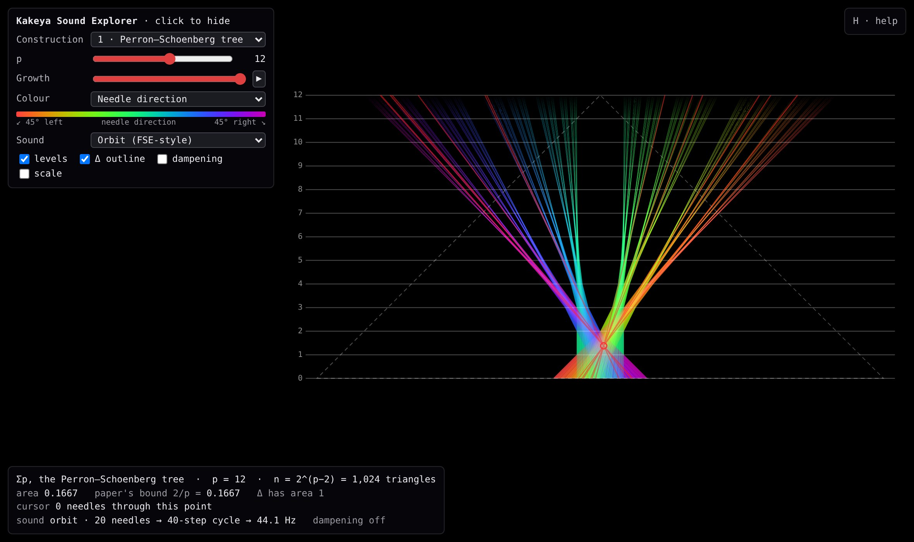
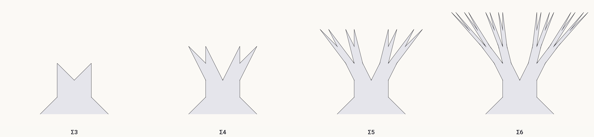
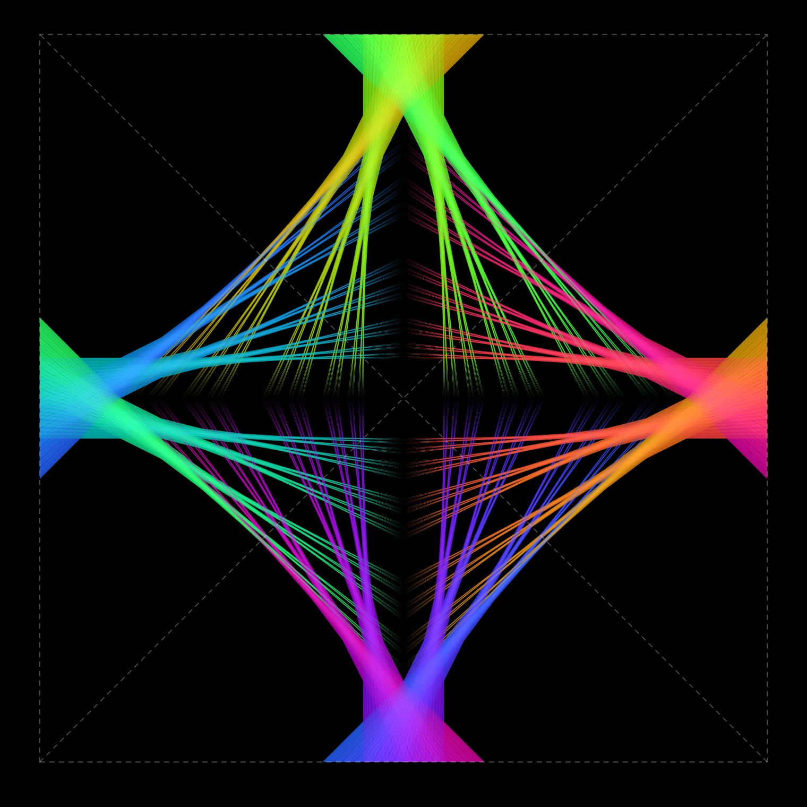
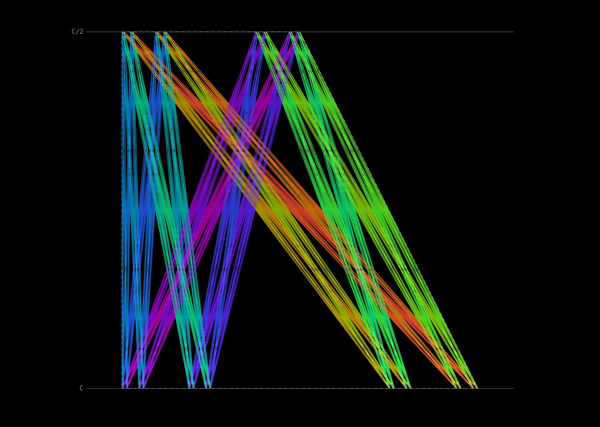
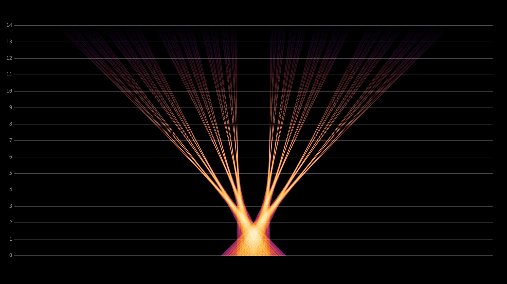

# Kakeya Sound Explorer

An audio-visual explorer for the Kakeya needle sets in A. S. Besicovitch's *The Kakeya Problem*
(American Mathematical Monthly 70, 1963, pp. 697–706). It is built the way HackerPoet's
[Fractal Sound Explorer](https://github.com/HackerPoet/FractalSoundExplorer) (FSE) is built. A
GLSL fragment shader runs one loop per pixel, and a synthesiser plays the point under the mouse as
a stereo waveform, x on the left channel and y on the right.

**To run it, open `index.html` in Chrome, Edge, Firefox or Safari.** Nothing needs to be installed
or served; the page needs WebGL 2.

## What it shows

| Key | Construction |
| --- | --- |
| 1 | **The Perron–Schoenberg tree Σp** (pp. 700–705). Start from the triangle Δ2, then p − 2 times bisect every triangle and expand both halves up to the next level. Σp is a union of n = 2^(p−2) triangles. Between them they contain a segment of length ≥ 1 in every direction of the original triangle Δ, whose area is 1. |
| 2 | **The full square** (Fig. 4). One tree on each side of the square, leaning in to the centre, so every direction all the way round appears. Pál joins (Fig. 5), which make it a set in which a needle can turn, are not drawn; they add arbitrarily little area. |
| 3 | **Kahane's version.** Every segment from a point of a Cantor set C on one line to a point of C/2 on a parallel line. This is the bridge to "ordinary" fractals; see below. |
| 4 | **The triangle Δ with nothing slid**, for comparison: same triangles, same directions, area 1. |

The growth slider (and `G`) moves continuously from Σ2 to Σp, which reproduces the paper's
"growth of the Perron–Schoenberg tree":

| Square, p = 9 | Kahane, depth 5 |
| --- | --- |
|  |  |

Colour modes (`C`): needle direction; number of needles through each point (below); and two
"paper" modes that draw every triangle (like Figs. 9–15) or only the outline (like Fig. 16).

## Is there really a similarity with the fractal explorer?

Yes, but it is more specific than "both look fractal", and the differences matter as much as
the likenesses.

**The limiting sets are genuinely fractal.** A set in the plane containing a unit segment in every
direction can have area zero (Besicovitch), yet any such set has Hausdorff dimension 2 (R. O.
Davies, 1971). Zero area with full dimension is exactly the kind of mismatch fractal geometry is
about. The Kakeya conjecture asks the same in R^n: dimension n. It was proved for n = 3 by Hong
Wang and Joshua Zahl in 2025 (arXiv:2502.17655) and is open for n ≥ 4.

**The pictures on screen are approximations, and they shrink only logarithmically.** Σp has area
2/p, where n = 2^(p−2) is the number of triangles, so the area is about 1.39/ln n. Córdoba's L²
argument (1977) shows you cannot do better than c/log n for some absolute c, however you slide
the n triangles. So Σp is optimal for its n up to a constant factor. The paper does not compute the
exact minimiser, and as far as I know it is not known for general n. The slow 1/log n is also why
the dimension is 2: area that decays slower than any power of the scale is what full dimension
looks like.

**The structure is that of an iterated function system, not of complex dynamics.** In "level units"
(multiply the paper's x and y by p, so the level line y = k/p becomes u = k), the slice of Σk at
height u is a union of 2^(k−2) intervals of length 2^(3−k)(k − u) whose left ends are

    u − 2 + Σ_j d_j w_j(u),    w_j(u) = 2^(−j) (j + 1 − u),    each d_j ∈ {0, 1}.

That is the same shape of formula as a Cantor set: subset sums of geometrically shrinking weights.
The weight w_j vanishes on level line j + 1, so on that line the triangles that differ only in
digit j sit exactly on top of each other. That is where the area is saved. Kahane (1969) made the
link explicit. Join the points of the middle-half Cantor set C on the line y = 0 to the points of
C/2 on y = 1. Each slice of the result is a projection of the four-corner Cantor set C × C, which
has length zero in almost every direction, and the slopes of the segments fill an interval. This is
the remark on the last page of the paper: lines whose set of parameters (poles) is an "irregular" set,
here C × C, cover zero area, and "the construction of irregular sets containing lines of all
directions presents no difficulty."

**The differences.** The Mandelbrot and Julia sets come from iterating one non-linear map, and
their self-similarity comes from the dynamics. A Kakeya set is the answer to an extremal problem,
so it is not unique; every construction is a choice. The maps involved are translations and
homotheties with ratios (k + 1)/k that change from level to level. Nothing chaotic happens. In
FSE's terms the tree is a cousin of an IFS fractal like the Sierpiński triangle, not of the
Mandelbrot set.

**A curiosity the explorer computes.** The paper proves area ≤ 2/p ("at most", because end pieces
might overlap). The exact computation here gives *equality*. Every horizontal slice of Σp between
level 1 and level p − 1 has total length exactly 2/p, against 2(1 − y) for Δ. Move the mouse and
read the HUD. The tests check this to rounding error for p ≤ 18. It follows that the average number
of needles through a point at height y is exactly p(1 − y). Proving it from the formula above
would make a nice exercise.

## How the parts map onto the Fractal Sound Explorer

| Fractal Sound Explorer | Kakeya Sound Explorer |
| --- | --- |
| `frag.glsl`: one function per fractal, chosen by `iType` | one function per construction, chosen by `iType` (same uniform names) |
| per pixel: iterate z → f(z, c) until \|z\|² > 1000 or `iIters` | per pixel: walk the binary tree of triangles, dropping a branch as soon as the pixel cannot lie in any triangle below it (the escape test) |
| colour by escape count or orbit statistics | colour by needle direction or by number of needles through the point |
| frames blended with alpha 1/(`iTime` + 1) | the same progressive anti-aliasing |
| click: play the orbit, one point per 1/4000 s, cosine-interpolated, x → left, y → right | click: play the *bush*, the directions of every needle through the point, as points on the unit circle, in the same cosine-interpolated style |
| a period-q orbit sounds at 4000/q Hz | m needles make a 2m-step cycle, at about 880/m Hz (about 1760 steps/s) |
| the orbit escapes → silence | no needle passes through the point → silence |
| D: dampening, volume × 0.9992 per step | D: the same decay rate |
| red line strip showing the orbit | red needles through the point |

A Kakeya set has no orbits. What a point does have is its bush, the needles through it, and the
number of them is exactly the quantity in Córdoba's L² argument and Bourgain's bush argument. So
the orbit sound turns multiplicity into pitch. A lone needle at the tip of a branch sounds at
about 880 Hz, and a point in the trunk under 20 needles at about 44 Hz. As p grows the trunk's pitch
falls, because the construction piles more triangles there. The chord mode (`A`) instead gives
every needle its own note, with pitch set by its direction, so a Kakeya set contains every pitch
somewhere.

## Controls

| Key / mouse | Action |
| --- | --- |
| Left mouse | Click or drag to hear a point |
| Middle drag, right drag, Shift + drag | Pan |
| Right click, Space | Stop the sound |
| Scroll wheel | Zoom about the cursor |
| 1–4 | Construction |
| ↑ / ↓ | p (depth m for Kahane) |
| ← / → (Shift: bigger steps) | Scrub the growth stage |
| G | Grow from Σ2 |
| C | Colour mode |
| A | Sound: orbit / chord / off |
| D | Audio dampening |
| Q | Snap chord pitches to a pentatonic scale |
| L, T | Level lines, outline of Δ |
| S, R, F, H | Snapshot, reset view, fullscreen, help |

URL parameters set the starting state, for example `index.html?type=0&p=14&color=1&sound=chord`.
Also available: `grow=`, `levels=0`, `ghost=0`, `ui=0` (hide the panels) and `scale=` (render
resolution; try `scale=0.5` on a slow GPU, `scale=2` for crisp snapshots on a high-DPI screen).

## Things to try

- Drag from the bottom of the trunk up one needle to the top of its branch. The pitch climbs as
  the needles thin out.
- Keep the same spot of the picture and press ↑ a few times. The pitch drops as n grows.
- Hold a point and press G. You hear the tree grow underneath it.
- Move the mouse up and down and watch "slice at this height" in the HUD.
- Colour by direction and compare Σp with mode 4. Every colour of Δ is still there, rearranged.
- Zoom into the crown at p = 16 or more. The branch tips split like a Cantor set.
- Kahane mode at depth 7–9: the area falls, but very slowly.

## Files and tests

- `index.html`: the whole app, with the geometry (`#kakeya-core`), synthesiser (`#synth-src`) and
  shaders inline, so the single file can be copied anywhere.
- `tests/core.test.mjs`: run `node tests/core.test.mjs` (Node 18+, no
  dependencies). It reads the scripts out of `index.html` and checks:
  - the closed form against a literal, vertex-by-vertex run of the paper's bisection and expansion;
  - the pruned tree walk against brute force;
  - the area and slice-length identity;
  - Kahane's direction set;
  - that every reported needle passes through its point;
  - the synthesiser's pitch, dampening and silence behaviour.

  The shader was also checked against the JS geometry pixel by pixel in headless Chromium: 99.8–100%
  of pixels agree, and the rest are float32 rounding on triangle edges.

## References

- A. S. Besicovitch, The Kakeya problem, *Amer. Math. Monthly* 70 (1963), 697–706.
- I. J. Schoenberg, On the Besicovitch–Perron solution of the Kakeya problem (1962), the version
  the paper follows.
- J.-P. Kahane, Trois notes sur les ensembles parfaits linéaires, *Enseignement Math.* 15 (1969).
- R. O. Davies, Some remarks on the Kakeya problem, *Proc. Cambridge Philos. Soc.* 69 (1971).
- C. Fefferman, The multiplier problem for the ball, *Ann. of Math.* 94 (1971). Besicovitch sets
  are why the ideal low-pass filter in two dimensions is unbounded on L^p for p ≠ 2.
- A. Córdoba, The Kakeya maximal function and the spherical summation multipliers, *Amer. J.
  Math.* 99 (1977).
- H. Wang and J. Zahl, Volume estimates for unions of convex sets, and the Kakeya set conjecture
  in three dimensions, arXiv:2502.17655 (2025).
- K. Falconer, *The Geometry of Fractal Sets*, ch. 7; E. M. Stein and R. Shakarchi, *Real
  Analysis*, ch. 7 (Kahane's construction).
- HackerPoet (CodeParade), Fractal Sound Explorer, MIT licence. This project reimplements its
  design (shader layout, uniform names, frame blending, the orbit-to-stereo synthesiser and its
  controls) rather than copying its code.
